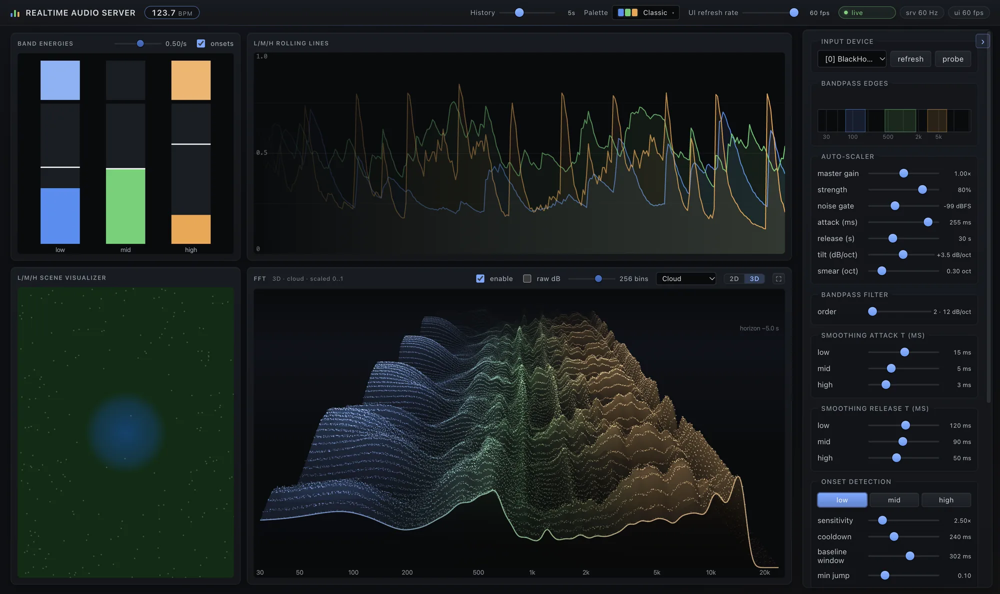
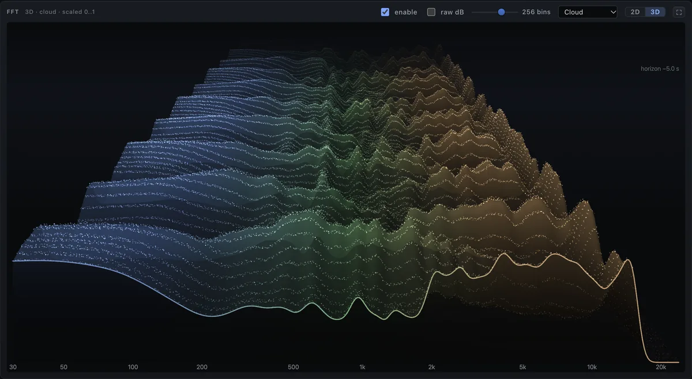
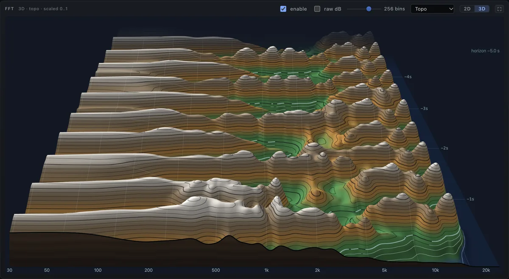
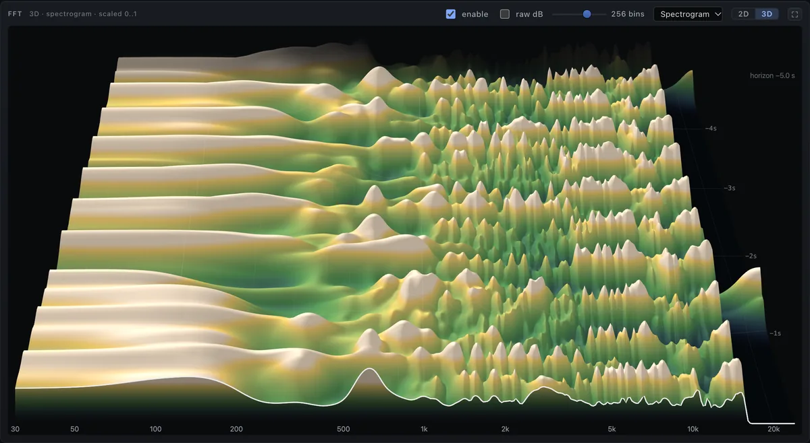
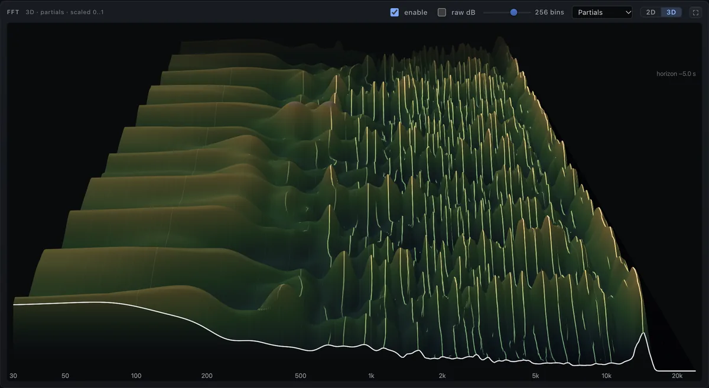
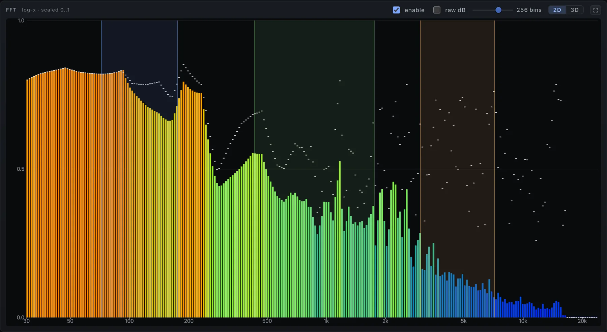
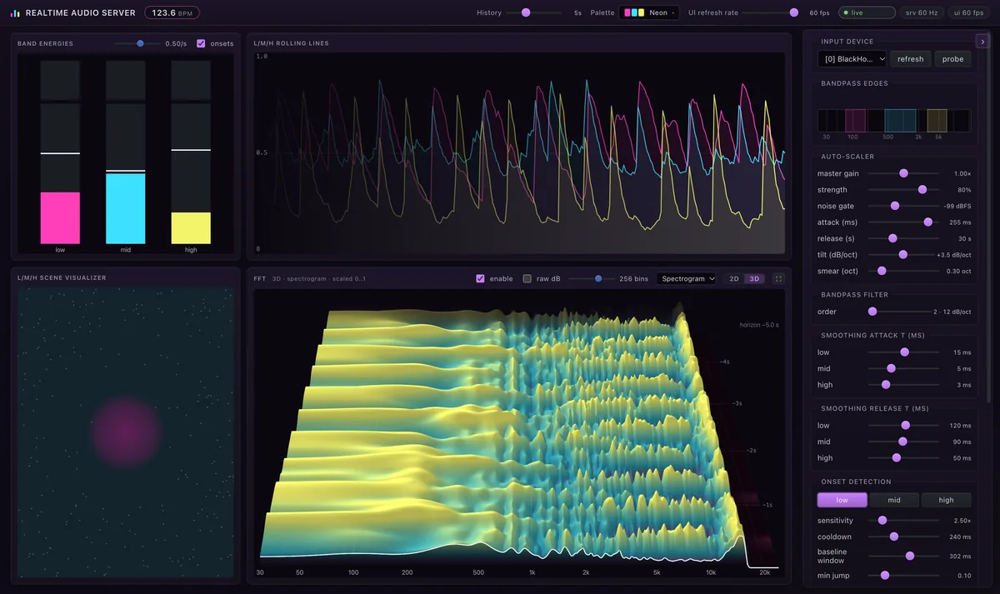
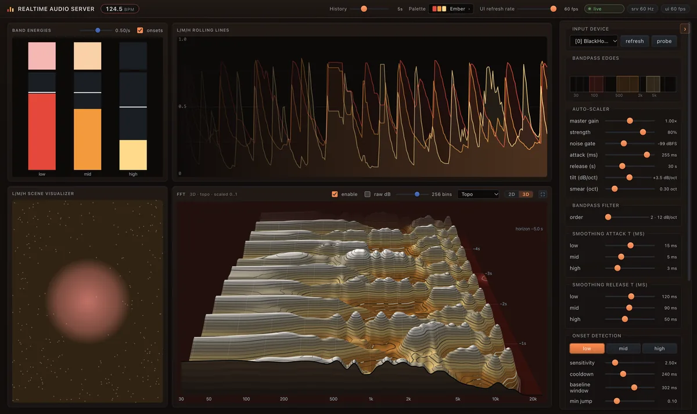
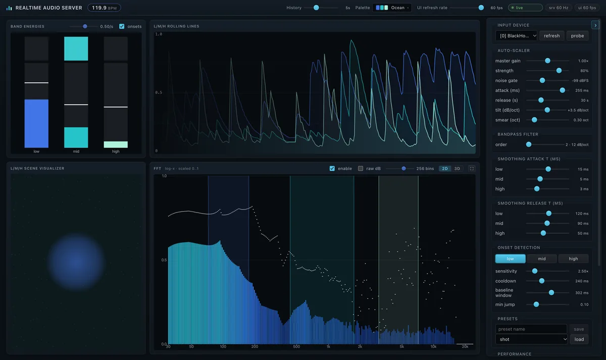
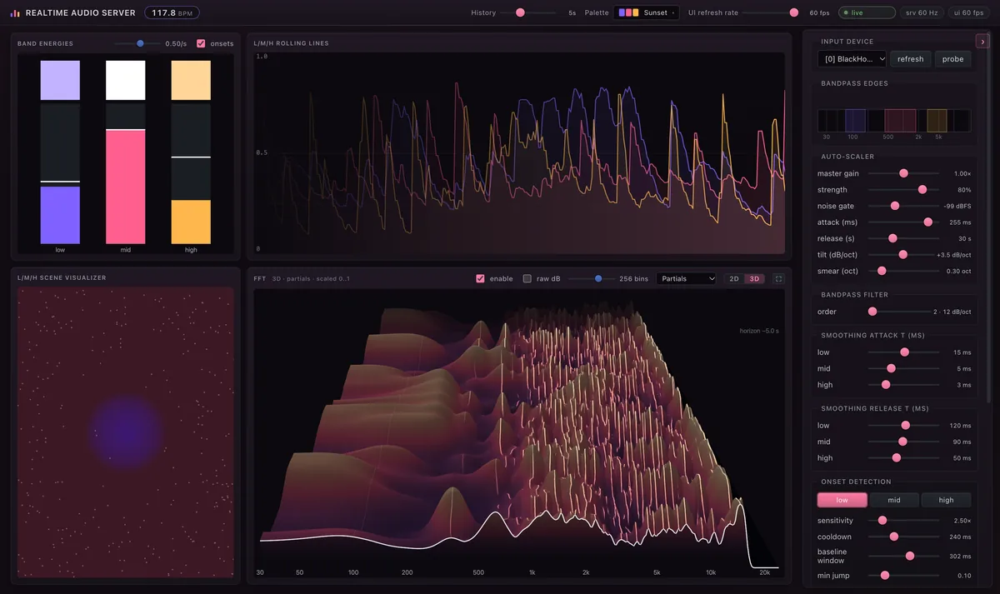

<h1 align="center">Realtime Audio Feature Server</h1>

<p align="center">
  <b>Live audio in → clean, auto-scaled features out over OSC + WebSocket, in under 15 ms.</b><br>
  For VJ tools, game engines, creative-coding sketches and anything else that should react to sound.
</p>

<p align="center">
  
  
  
  
  <a href="LICENSE"></a>
</p>

https://github.com/user-attachments/assets/83547924-0b8d-4667-ba55-5cb813fdc09d

## Features

| | |
|---|---|
| **Band energies** | Three independent bandpasses (low / mid / high), each smoothed, noise-gated and auto-scaled to a stable `[0, 1]` signal. |
| **FFT spectrum** | 16–1024 log-spaced bins, auto-scaled through the same pipeline or sent as raw dB. |
| **Onsets and tempo** | Per-band onset triggers for kick, snare and hi-hat style transients, plus a BPM estimate from the low band. |
| **OSC output** | UDP at audio-block rate (~187 Hz) for TouchDesigner, Max/MSP, Unity, p5.js or custom clients. A WebSocket handles live control. |
| **Browser UI** | Tune every parameter live. The UI does no signal processing: the FFT graph renders the exact bytes sent on `/audio/fft`. |
| **Realtime-safe** | The audio callback never allocates, locks or logs. All DSP runs in worker threads on vectorized NumPy / SciPy, light enough for a Raspberry Pi. |
| **Persistence** | Every setting is saved to `configs/main.yaml`. Named presets can be saved and loaded. |

## The UI

<p align="center">
  
</p>

## Quick start

You need Python 3.10+, [uv](https://docs.astral.sh/uv/) and PortAudio.

```bash
brew install portaudio                               # macOS
sudo apt install libportaudio2 portaudio19-dev       # Ubuntu / Debian / Raspberry Pi OS

git clone https://github.com/aiXander/Realtime_PyAudio_FFT.git
cd Realtime_PyAudio_FFT
uv sync
uv run audio-server --open                           # server + UI in your browser (or: make start)
```

The UI lives at **http://127.0.0.1:8766**. OSC goes to `127.0.0.1:9000` by default.

| Flag | What it does |
|---|---|
| `--open` | Open the UI in your default browser |
| `--device N` | Use input device `N` (pick it in the UI otherwise) |
| `--no-ws` | Headless: OSC only, no UI or WebSocket (e.g. a Pi at a gig) |
| `--config PATH` | Use another config file instead of `configs/main.yaml` |
| `--log-level DEBUG` | More logging |

> [!TIP]
> To react to what your computer is *playing* rather than a mic, route system audio into a loopback device ([BlackHole](https://github.com/ExistentialAudio/BlackHole) on macOS, a loopback / monitor device on Linux or Windows) and select it as the input.

## FFT views and palettes

The FFT card has a **2D view**, the exact picture of the OSC payload with the three bandpasses overlaid (drag their edges right on the canvas), and a **3D view** that shows the last few seconds of spectrum as a landscape, in four styles:

<table>
  <tr>
    <td width="50%"><p align="center"><b>Cloud</b>: dust-like point cloud in band colors</p></td>
    <td width="50%"><p align="center"><b>Topo</b>: survey map with contour lines</p></td>
  </tr>
  <tr>
    <td width="50%"><p align="center"><b>Spectrogram</b>: magnitude colormap on a time grid</p></td>
    <td width="50%"><p align="center"><b>Partials</b>: tracks and highlights tonal peaks</p></td>
  </tr>
  <tr>
    <td colspan="2"><p align="center"><b>2D</b>: the exact OSC payload, with bandpass overlays and peak-hold markers</p></td>
  </tr>
</table>

Pick a palette from the top bar and it recolors everything, the 3D styles included:

<table>
  <tr>
    <td width="50%"><p align="center">Neon</p></td>
    <td width="50%"><p align="center">Ember</p></td>
  </tr>
  <tr>
    <td width="50%"><p align="center">Ocean</p></td>
    <td width="50%"><p align="center">Sunset</p></td>
  </tr>
</table>

## Receiving features over OSC

| Address | Args | When |
|---|---|---|
| `/audio/lmh` | `low mid high` (floats, `~[0, 1]`) | Every audio block (~187 Hz) |
| `/audio/onset/low` · `/mid` · `/high` | `1` | Once per detected onset on that band (no `0`s are sent) |
| `/audio/bpm` | `bpm` | Every block. Octave-folded into 60–180, `0` until locked or after 5 s of silence |
| `/audio/fft` | `n_bins` floats | Every FFT hop (~94 Hz), only when `osc.send_fft: true` |
| `/audio/meta` | `sr blocksize n_fft_bins low_lo low_hi mid_lo mid_hi high_lo high_hi` | On start, on changes, and once a second |

FFT bins are auto-scaled `[0, 1]` by default. Tick **raw dB** in the UI (or set `fft.send_raw_db: true`) to get the raw log spectrum instead. Add more destinations in `configs/main.yaml`:

```yaml
osc:
  destinations:
    - { host: 127.0.0.1, port: 9000 }
    - { host: 192.168.1.42, port: 7000 }
  send_fft: true
```

<details>
<summary><b>Minimal Python receiver</b></summary>

```python
from pythonosc import dispatcher, osc_server

d = dispatcher.Dispatcher()
d.map("/audio/lmh", lambda _, low, mid, high: print(f"L={low:.2f} M={mid:.2f} H={high:.2f}"))
d.map("/audio/onset/low", lambda *_: print("kick!"))
d.map("/audio/bpm", lambda _, bpm: None)
d.map("/audio/fft", lambda _, *bins: None)

osc_server.BlockingOSCUDPServer(("127.0.0.1", 9000), d).serve_forever()
```

**TouchDesigner / Max:** point an OSC In CHOP / `udpreceive` at port 9000; `/audio/lmh` arrives as three channels.
</details>

## Controlling the server over WebSocket

Connect to `ws://127.0.0.1:8765`. Any number of clients can connect at once. The server sends JSON text frames plus binary FFT frames, and accepts JSON commands. Each command is validated first: a bad one gets an `error` reply and changes nothing.

```js
const ws = new WebSocket("ws://127.0.0.1:8765");
ws.binaryType = "arraybuffer";
ws.onopen = () => ws.send(JSON.stringify({ type: "set_band", band: "low", lo_hz: 40, hi_hz: 160 }));
ws.onmessage = (ev) => {
  if (typeof ev.data !== "string") {                       // binary FFT frame
    const n = new DataView(ev.data).getUint16(2, true);
    const bins = new Float32Array(ev.data, 4, n);
  } else if (JSON.parse(ev.data).type === "snapshot") {
    /* msg.low / msg.mid / msg.high, msg.bpm, msg.low_onset … */
  }
};
```

<details>
<summary><b>Messages the server sends</b></summary>

| `type` | Key fields | When |
|---|---|---|
| `meta` | Every current setting: sample rate, bands, smoothing, autoscale, onset, FFT and UI settings, device | On connect and after any change. Treat it as the source of truth. |
| `snapshot` | `low mid high` (scaled), `low_raw mid_raw high_raw`, `low_onset mid_onset high_onset` (0/1), `bpm`, `seq`, `t` | At `ws.snapshot_hz` (default 60) |
| *binary* | `[type=1:u8][reserved:u8][n_bins:u16 LE][float32 × n_bins LE]` | Every FFT hop while FFT is on. Same bytes as `/audio/fft`. |
| `devices` | `items: [{index, name, hostapi, default_samplerate, max_input_channels, …}]` | On connect and in reply to `list_devices` |
| `presets` | `items: [{name, saved_at}]` | On connect and after preset changes |
| `server_status` | Drop counters, per-stage timings, `audio_stalled` | ~2 Hz, diagnostics |
| `error` | `reason` | Reply to an invalid command |

Onsets are never lost between snapshots: if one fired since the last snapshot, the next snapshot carries `*_onset = 1`.
</details>

<details>
<summary><b>Commands you can send</b></summary>

Sliders can send `commit: false` while dragging and `commit: true` on release. The change applies immediately either way; only the write to disk is debounced.

| `type` | Fields |
|---|---|
| `set_band` | `band: "low"\|"mid"\|"high", lo_hz, hi_hz` |
| `set_smoothing` | `tau: {low?, mid?, high?}`, `tau_attack: {…}` (seconds, 0.005–2) |
| `set_autoscale` | any of `tau_attack_s` (0.001–1), `tau_release_s` (5–300), `noise_floor` (0–0.1), `strength` (0–1), `master_gain` |
| `set_onset` | `band`, any of `sensitivity`, `refractory_s`, `slow_tau_s`, `abs_floor` |
| `set_fft` | `enabled: bool` |
| `set_n_fft_bins` | `n` (16–1024) |
| `set_fft_send_raw_db` | `send_raw_db: bool` |
| `set_fft_peak_smear` | `peak_smear_oct` (0–3) |
| `set_fft_tilt` | `tilt_db_per_oct` (−6 to 12) |
| `set_filter_order` | `order` (1–8) |
| `set_ws_snapshot_hz` | `hz` (15–240) |
| `list_devices` | `probe?: bool` (briefly opens each input to see which has signal) |
| `set_device` | `index` (hot-switches the input) |
| `list_presets` · `save_preset` · `load_preset` | `name` (1–64 chars, `[A-Za-z0-9_\- ]`) |
| `set_fft_view` · `set_fft3d_style` · `set_palette` · `set_ui_layout` · `set_peak_decay` · `set_show_onsets` | UI appearance, saved on the server so every browser looks the same |

`set_smoothing` and `set_autoscale` drive the L/M/H bands *and* the FFT bins together. So you can tune the bands by watching the high-resolution FFT, and the L/M/H output follows the same response.
</details>

## How it works

<p align="center">
  
</p>

- **The audio callback does almost nothing.** It mixes to mono, copies the block into a lock-free ring buffer and wakes two workers. It never allocates, locks, logs or sends a packet, so heavy load can't cause dropouts.
- **DSP worker** (once per 256-sample block): bandpass filter bank → RMS → smoothing → auto-scaler (peak follower + noise gate + tanh) → onset detection → OSC.
- **FFT worker** (once per hop): windowed FFT → log-spaced bins → the same per-bin auto-scaler → OSC + WebSocket.
- **The asyncio loop** runs the WebSocket server, the UI's static HTTP server, the command dispatcher and the debounced config writer.
- **The audio watchdog** sends silence to OSC and keeps trying to reopen the device when the input dies (e.g. an unplugged USB mic).

The full design rationale is in [`realtime_audio_server_plan.md`](realtime_audio_server_plan.md).

## Configuration

- `configs/main.yaml` is created from [`configs/main.example.yaml`](configs/main.example.yaml) on first run and **rewritten automatically** whenever you change something in the UI. The server writes it but doesn't watch it, so restart after editing it by hand.
- Presets are saved next to it as `configs/<name>.yaml`.
- The input device is remembered **by name**, so it survives devices being re-ordered.
- Running headless (`--no-ws`)? Tune with the UI first, then restart without it; the settings stay.

## License

[MIT](LICENSE) © Xander Steenbrugge
